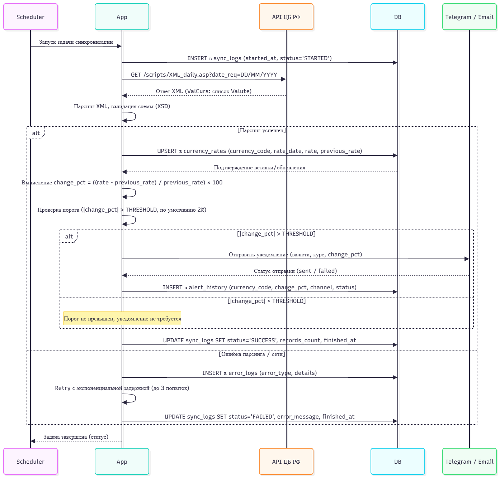
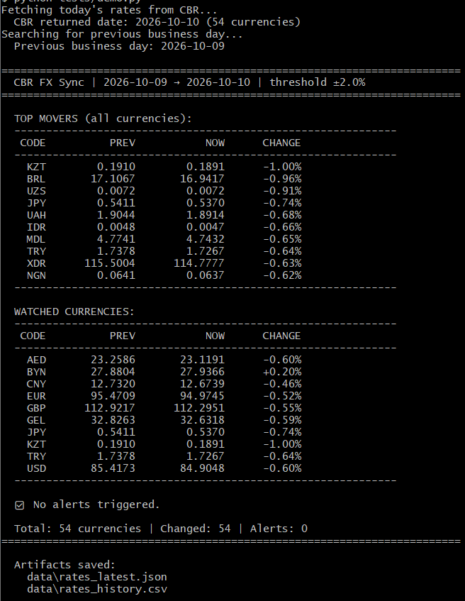

# currency-rates-integration
Интеграция курсов валют ЦБ РФ с автоматическими уведомлениями
# Интеграция курсов валют ЦБ РФ

## Описание проекта
Автоматизированная система получения и обработки курсов валют с официального API ЦБ РФ.

## Архитектура


## Технические требования
* Python 3.10+
* PostgreSQL 14+
* XML-парсер
* Telegram/Email для уведомлений

## Установка
```bash
pip install -r requirements.txt
```
## Настройка базы данных
```bash
python setup_db.py
```
## Основные компоненты
* Парсер XML — обработка данных ЦБ РФ.
* База данных — хранение курсов и уведомлений.
* Система уведомлений — отправка оповещений при резких колебаниях.
* Мониторинг — отслеживание состояния системы.

## Запуск парсера
```bash
python main.py
```
## Запуск тестов
```bash
python -m pytest tests/
```
# !!! Пароли доступа хранятся в os.env. В репозитории представлен файлом-заглушкой для заполнения.

## Демо

